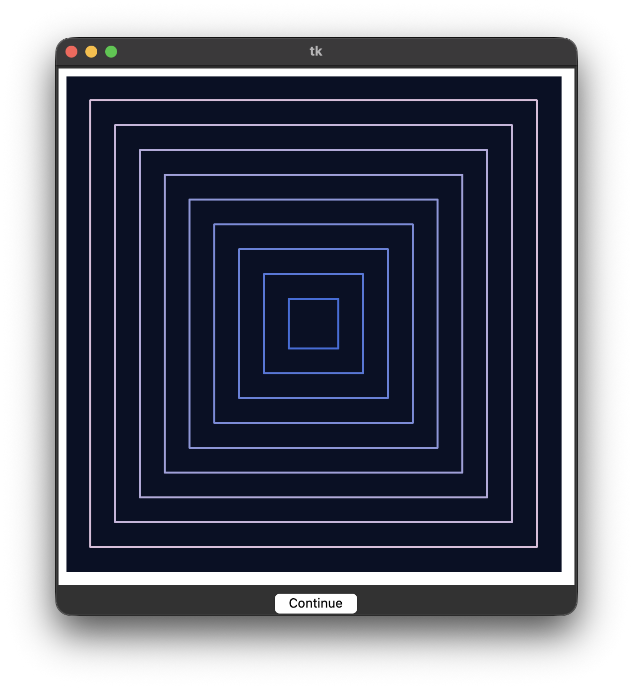

# VecSketch Interpreter

VecSketch is a small interpreter for drawing two-dimensional shapes with a
simple language. Programs are saved in `.vec` files and use numbers, shapes,
variables, loops, conditions and function calls.



## Running a program

```bash
uv run python run.py examples/simple-house.vec
uv run python run.py examples/math-spiral.vec
uv run python run.py examples/math-squares.vec
```

The program opens a Tkinter drawing window. `pause` waits for the Continue
button, and the interpreter closes the window after the user closes it.

## Basic syntax

Names of variables and types begin with a lowercase letter:

```vec
number size = 10
shape square = +[0,0]-[size,0]-[size,size]-[0,size]-[0,0]
```

Available types:

| Type     | Meaning                |
| -------- | ---------------------- |
| `number` | Integer number         |
| `shape`  | Point, line or polygon |

Strings are written in double quotes. Items can be joined with `&`:

```vec
print "size:" & size
```

Comments start with `/%` and end with `/%`:

```vec
/% This is a comment %/
```

## Shape syntax

Coordinates use `[x,y]`. A minus sign joins coordinates into a point or line:

```vec
shape point = [10,20]
shape line = [0,0]-[30,20]
```

Prefix the first coordinate with `+` to create a polygon:

```vec
shape triangle = +[0,0]-[20,0]-[10,20]-[0,0]
```

The supported shape operations are:

| Operation         | Meaning                         |
| ----------------- | ------------------------------- |
| `shape1 + shape2` | Union                           |
| `shape1 - shape2` | Difference                      |
| `shape1 * shape2` | Intersection                    |
| `shape * number`  | Scale around `(0,0)`            |
| `shape / number`  | Rotate counterclockwise         |
| `shape -> [x,y]`  | Move by `x` and `y`             |
| `+shape`          | Polygonize                      |
| `-shape`          | Downgrade to boundary or points |

```vec
shape small = square * 2
shape moved = small -> [20,30]
shape rotated = moved / 45
```

Use `.x`, `.y`, `.xmin`, `.ymin`, `.xmax` or `.ymax` to read shape properties:

```vec
number center_x = square.x
number center_y = square.y
```

## Drawing commands

```vec
draw shape
draw shape (255,128,0)
pause
clear
wait 2
```

`draw` renders a shape. RGB values can be numbers or expressions from `0` to
`255`. `pause` waits for Continue, `clear` clears the window, and `wait`
pauses for a given number of seconds.

## Numbers and assignments

The assignment operator is `:=`.

```vec
number ii = 1
ii := ii + 1
```

Supported operators:

- Arithmetic: `+`, `-`, `*`, `/`
- Comparison: `=`, `/=`, `<`
- Unary minus: `-number`

## Conditions and loops

```vec
if ii < 10 then
  print ii
else
  print "done"
endif
```

```vec
while ii < 10 is
  print ii
  ii := ii + 1
endwhile
```

A zero value is false and a non-zero value is true.

## Functions and procedures

Function names begin with at least two uppercase letters and use braces:

```vec
define ADD{ a : number; b : number } return number
is
  a + b
end

print ADD(3,4)
```

Procedure names begin with an uppercase letter and use square brackets:

```vec
define SHOW[ value : number ]
is
  print value
end

SHOW(42)
```

## AST and DOT

To print the abstract syntax tree as Unicode or DOT:

```bash
uv run python full_ast.py -t unicode examples/math-squares.vec
uv run python full_ast.py -t dot examples/math-squares.vec > examples/math-squares.dot
dot -Tsvg examples/math-squares.dot -o examples/math-squares.svg
```
